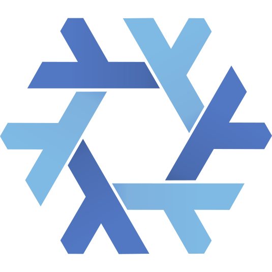

<div align="center">



# core.nix

_My personal NixOS configuration and dotfiles as a single flake._

[](https://nixos.org)
[](https://wiki.nixos.org/wiki/Flakes)
[](https://www.lua.org)
[](LICENSE)
[](https://ko-fi.com/farbzen)

[Overview](#overview) • [Features](#features) •
[Getting Started](#getting-started) • [Usage](#usage) •
[Documentation](#documentation)

</div>

core.nix holds every machine I run on NixOS plus the dotfiles of my user in one
repository. Hosts are composed from small, reusable feature modules, so a new
machine is mostly a list of imports, a disk layout and a hardware report.

## Overview

The flake is built with [flake-parts](https://flake.parts) and loads every file
below `modules/` automatically via
[import-tree](https://github.com/vic/import-tree). Each file contributes
`flake.nixosModules.*`, `flake.nixosConfigurations.*` or wrapped packages.

The repository consists of the following parts:

- **Hosts** – one `nixosConfiguration` per machine, partitioned with
  [disko](https://github.com/nix-community/disko) and detected with
  [nixos-facter](https://github.com/nix-community/nixos-facter). The code lives
  in `modules/hosts/`.
- **Features** – reusable NixOS modules (boot, desktop, graphics, VPN, …)
  composed by the hosts. The code lives in `modules/features/`.
- **Users** – user accounts with their packages. The code lives in
  `modules/users/`.
- **Neovim** – a fully wrapped Neovim with plugins, LSPs and formatters, built
  with [nix-wrapper-modules](https://github.com/BirdeeHub/nix-wrapper-modules).
  The code lives in `modules/features/editor/neovim.nix`, the Lua config in
  `dots/farbzen/dot-config/nvim/`.
- **Dotfiles** – user configuration (Hyprland, DankMaterialShell, fish, kitty,
  foot, tmux, yazi, …) managed with
  [GNU Stow](https://www.gnu.org/software/stow/). The code lives in
  `dots/farbzen/`.
- **Secrets** – VPN credentials encrypted with
  [sops-nix](https://github.com/Mic92/sops-nix) and age. The files live in
  `.secrets/`.

| Host     | Purpose                                                      |
| -------- | ------------------------------------------------------------ |
| `omegon` | Main workstation: Hyprland, Steam, QEMU, Docker, SSH, VPNs   |
| `corax`  | Laptop with NVIDIA PRIME offload: Hyprland, Steam, WireGuard |
| `vulkan` | GNOME desktop with NVIDIA and Steam                          |
| `erda`   | Minimal live ISO with GNOME                                  |

## Features

- **Modular hosts**: every feature is a `nixosModules.*` entry and can be
  imported by any host.
- **Shared base**: `baseConfig` bundles audio, locale, shell, editor, tmux,
  networking and Nix settings for every machine.
- **Declarative disks**: disko layouts make reinstalls reproducible.
- **Encrypted secrets**: OpenVPN and WireGuard configs are rendered from sops
  templates at activation time.
- **Binary cache**: builds are pulled from `farbzen.cachix.org`.
- **Hyprland desktop**: Hyprland via UWSM with DankMaterialShell, greeter and
  switchable monitor profiles.

## Getting Started

### Prerequisites

- A machine booted into a NixOS installer (or the `erda` ISO)
- Nix with `nix-command` and `flakes` enabled
- The age key at `~/.config/sops/age/keys.txt` for hosts using VPN secrets

### Installation

Partition the disk with the host's disko layout and install the system:

```sh
sudo nix run github:nix-community/disko -- --mode disko \
  modules/hosts/<host>/_disko-config.nix
sudo nixos-install --flake .#<host>
```

> [!IMPORTANT]
> disko wipes the target disk. Check the device in `_disko-config.nix` before
> running it.

Link the dotfiles into the home directory and install the tmux plugin manager:

```sh
stow --dotfiles -d dots -t ~ farbzen
dots/farbzen/dot-config/scripts/dotfiles_install.sh
```

> [!NOTE]
> The dotfiles use Stow's `dot-` prefix convention, so `dot-config` becomes
> `~/.config`.

## Usage

Apply the configuration of the current host:

```sh
sudo nixos-rebuild switch --flake .#<host>
```

Build the live ISO:

```sh
nix build .#nixosConfigurations.erda.config.system.build.isoImage
```

Edit an encrypted secret:

```sh
sops .secrets/openvpn.yaml
```

Enter the development shell (Nix language tooling via
[devenv](https://devenv.sh)):

```sh
devenv shell
```

> [!TIP]
> Pick a Hyprland monitor layout with
> `~/.config/scripts/hypr_select_monitor_profile.sh`; it copies a profile from
> `hypr/monitors/` to the git-ignored `hypr/outputs.lua`.

## Documentation

- [Modules](docs/modules.md) – all NixOS modules and which hosts use them

## Special thanks

This flake is the result of a lot of experimenting and following various people
over time. As such, I want to thank:

- [Vimjoyer](https://www.youtube.com/@vimjoyer) - For covering lots of very
  useful and interesting topics pertaining to Nix and NixOS (Basically being,
  what the NixOS Wiki wishes it was)
- [Tris](https://www.youtube.com/@NoBoilerplate) - For sharing intriguing ideas
  and making me challenge established workflows
- [ThePrimagen](https://www.youtube.com/@ThePrimeagen) - For introducing me to
  Neovim and basically starting the journey that led me here
